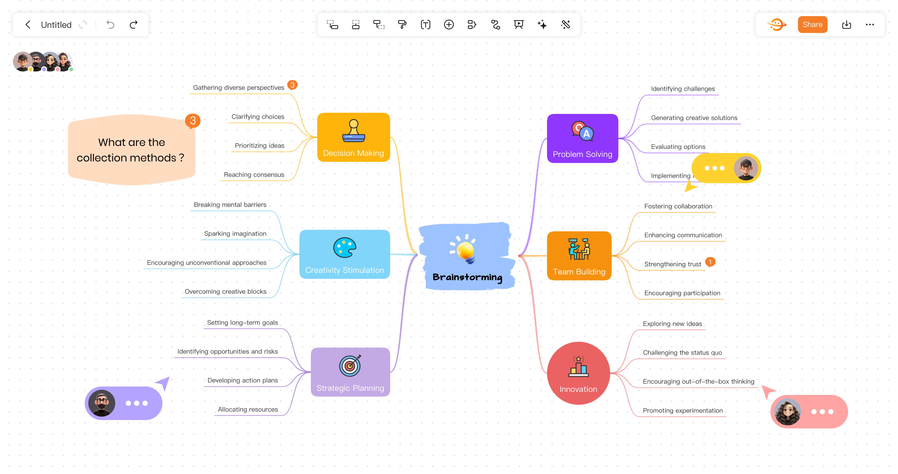
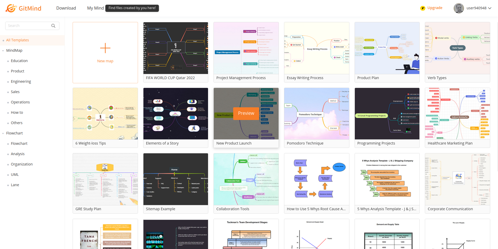

# GitMind AI Mind Mapping and Visual Planning

[](SILKA)

GitMind combines mind mapping, diagrams and AI-assisted summaries in a shared visual workspace.
Use gitmind ai to turn source material into a draft structure, then refine the result around your own purpose.

A gitmind mind map can organize study topics, project decisions or the outline of a presentation.
This guide focuses on the web workspace, where editing and import features evolve through service updates.

## Mind Map Editing

Build the hierarchy around a clear central topic.
Add related ideas as branches, then separate supporting details from the main argument.

- Create child topics for details that belong under one idea.
- Create sibling topics for ideas at the same level.
- Move branches when the relationship between topics changes.
- Copy useful branches when a repeated structure saves work.
- Use floating nodes for ideas that do not yet fit the hierarchy.

The documented web editor uses Tab for a child node and Enter for a sibling.
Toolbar and context-menu actions provide alternatives to keyboard shortcuts.

Before adding more detail, read the first branch level as a short outline.
If that outline is difficult to explain, revise it before expanding the map.



## Structure Before Decoration

| Planning question | Useful representation | Review before sharing |
| --- | --- | --- |
| What belongs under this idea? | Mind map hierarchy | Each child should clarify its parent |
| Who reports to whom? | Organization chart | Reporting lines should have one clear meaning |
| What happens next? | Flowchart | Decision paths should reach a stated outcome |
| Why did this happen? | Fishbone diagram | Separate observed causes from assumptions |
| What changes over time? | Timeline | Keep dates and sequence consistent |
| How do concepts compare? | Table layout | Use equivalent categories across entries |

Choose a representation for the question you need to answer.
A gitmind map becomes easier to maintain when each branch has a clear role.

## Layouts and Relationships

GitMind offers several map and chart layouts.
The web release history also documents radial, bubble, grid and table layouts.

Use the hierarchy for parent-child relationships.
Use additional relationship lines when an idea depends on a topic elsewhere in the map.

A relationship label should explain why the connection matters.
Avoid adding a connector simply because two topics happen to be near each other.

For a crowded map, try these editorial changes:

- Shorten labels that repeat their parent's wording.
- Separate decisions from background information.
- Move unrelated questions into another map or canvas.
- Keep the most important comparison visible at the same scale.

## Topic Styling and Themes

The editor provides theme choices and controls for text, node appearance and backgrounds.
Choose a consistent visual language before styling individual branches.

Reserve the strongest emphasis for decisions, deadlines or unresolved questions.
When every topic uses a different treatment, the reader must decode the formatting before reading the content.

- Use one treatment for ordinary topic labels.
- Give open questions a recognizable appearance.
- Keep text readable against its background.
- Check the map at the size your audience will actually see.

Theme selection supports presentation, but the hierarchy should still make sense without color.
Use wording and branch position to carry the essential meaning.

## Markdown as an Input Format

GitMind supports importing a Markdown file into an editable mind map.
A short outline is useful when you want to prepare the structure in a text editor first.

The following example describes a small product review.

```markdown
# Product review
## Evidence
- User interviews
- Support themes
## Decisions
- Keep the current scope
- Schedule a follow-up review
```

Save the content as a Markdown file.
In My Mind, choose More, then Import local file, upload the file and confirm the import.

Compare the imported hierarchy with the original outline.
Conversion is a useful starting point, and the resulting branches still benefit from editing.

## Checking an Outline with PowerShell

This optional example uses Windows PowerShell to inspect a local Markdown file before import.
It reads text only; it is separate from GitMind's web interface.

```powershell
$outline = Get-Content -LiteralPath '.\review.md' -Encoding UTF8
$outline | Select-String -Pattern '^#{1,6}\s'
$outline | Select-String -Pattern '^\s*-\s'
```

Replace the example path with the Markdown file you prepared.
The two filters show headings and bullet lines so you can review the structure.

No GitMind command-line tool is required for this workflow.
File import happens through the application's interface.



## AI-Assisted Drafting

GitMind can generate visual summaries from prompts and supported source material.
Its tools cover text, documents, websites, images, audio and video workflows.

Give the tool a specific purpose rather than asking for every possible detail.
For a study map, request concepts and examples; for a project review, focus on decisions and outstanding questions.

After generation, review the map in three passes:

1. Compare central claims with the original material.
2. Rename branches whose labels are too broad.
3. Remove repeated points and add missing qualifications.
4. Put unresolved questions where a reviewer can find them.

Keep the source available while checking the result.
A compact visual summary is most useful when its meaning remains traceable to the material you supplied.

## Flowcharts and Process Diagrams

The gitmind flowchart maker addresses processes that need steps, decisions and outcomes.
Use it when sequence matters more than a radial arrangement of ideas.

Write each action as a short verb phrase.
Keep decision questions distinct from actions so readers can follow the alternatives.

For a process review, check:

- The starting condition is explicit.
- Each decision has understandable outgoing paths.
- Repeated steps use consistent names.
- Exceptions have a visible destination.
- The end condition matches the process goal.

A process diagram and a topic map can serve different parts of the same discussion.
Keep their purposes clear when presenting them together.

## Collaboration and Review

GitMind supports sharing and collaborative editing.
Use gitmind online to discuss a shared map while keeping the branch structure visible to the group.

Before a review, decide whether participants are collecting ideas or approving a structure.
Those activities benefit from different levels of detail.

After a discussion, resolve duplicate branches and make decisions explicit.
A map is easier to revisit when unresolved questions are separated from agreed actions.

## Export and Presentation

Choose an export that matches how the map will be read.
A meeting display, a document attachment and a printed handout need different levels of detail.

The web workspace includes export and print-related controls.
Inspect a preview before distributing a large diagram.

- Check that small labels remain legible.
- Look for branches split across page boundaries.
- Review orientation and paper size for printed material.
- Keep an editable copy for future revisions.

## Related Search Terms

gitmind ai, gitmind mind map, gitmind map, gitmind online, gitmind flowchart maker, mind-map, mind-mapping, mindmap, mindmapping, knowledge-management, note-taking, outliner, presentation, project-management, diagram
